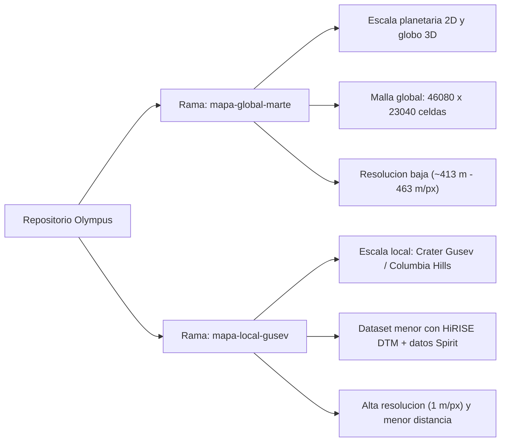
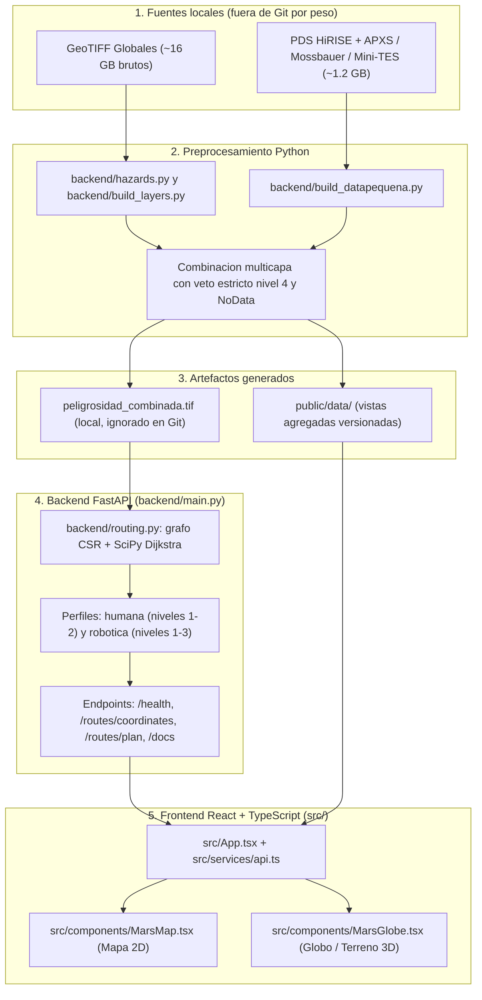

# Olympus — Navegacion y analisis de peligrosidad en Marte

Plataforma de planificacion de rutas marcianas y evaluacion multicapa de peligrosidad (geologia, accidentes del terreno, radiacion y pendientes) mediante procesamiento raster en Python, calculo geoespacial con FastAPI + SciPy Dijkstra y visualizacion interactiva 2D/3D en React y Three.js.

## Estructura de ramas del proyecto

El repositorio se organiza unicamente en dos ramas activas segun la escala espacial y resolucion del mapa:



- **`mapa-global-marte`**: version planetaria completa con mapa equirrectangular 2D y globo 3D de Marte.
- **`mapa-local-gusev`**: version focalizada de alta resolucion (1 m/px) sobre la zona de aterrizaje y exploracion del rover Spirit en el crater Gusev (Columbia Hills).

## Arquitectura del sistema



### Estructura de archivos principales

```text
Olympus/
├── backend/
│   ├── main.py                # API FastAPI, CORS, logging rotativo y Swagger (/docs)
│   ├── routing.py             # Grafo disperso CSR, Dijkstra geodetico y perfiles de mision
│   ├── hazards.py             # Validacion y combinacion de los 4 rasteres globales
│   ├── build_layers.py        # Exportacion de capas individuales para el visor web
│   ├── build_real_surface.py  # Texturas y superficie real (Viking + MOLA)
│   ├── build_datapequena.py   # Generacion de rasteres 1 m/px para Gusev (en mapa-local-gusev)
│   ├── points.json            # Puntos de interes predefinidos
│   └── test_api.py            # Pruebas automatizadas de API y ruteo
├── src/
│   ├── App.tsx                # Estado principal, seleccion de puntos, capas y perfiles
│   ├── services/api.ts        # Cliente HTTP hacia FastAPI
│   ├── components/MarsMap.tsx # Visor 2D interactivo con zoom y trazado de ruta
│   └── components/MarsGlobe.tsx # Visor 3D en Three.js
├── public/data/               # Previsualizaciones PNG/JSON versionadas para la interfaz
├── LICENSE                    # Licencia MIT con atribucion obligatoria
└── README.md
```

## Limitaciones tecnicas y alcance cientifico

### 1. Precision y error de distancia en el modelo global (`mapa-global-marte`)

El modelo global presenta un **margen de error considerable al calcular distancias y trayectorias**. Esto ocurre porque cada pixel de la malla global equirrectangular (46 080 x 23 040 celdas) representa entre ~413 m y 463.09 m de terreno marciano (con capas y ventanas que superan los ~413 MB en disco/procesamiento y ~16 GB en conjunto bruto). Ademas, para evitar exceder la memoria y el tiempo limite en tramos largos, el motor aplica submuestreo adaptativo (`stride`), agrupando bloques de celdas de forma conservadora.

Para reducir este error y lograr un ajuste metrico mas preciso a escala planetaria se requiere:
- **Mayor potencia de computo** (capacidad de memoria RAM, CPU multinucleo o aceleracion en GPU para procesar grafos masivos sin reducir resolucion).
- **Datos globales mas precisos** (modelos digitales de elevacion y capas tematicas mundiales de mayor resolucion espacial).

### 2. Objetivo de la rama con dataset menor (`mapa-local-gusev`)

La rama `mapa-local-gusev` resuelve la limitacion de escala anterior utilizando un **dataset acotado geograficamente pero de alta resolucion (1 m/px)** sobre el crater Gusev (Columbia Hills), generado a partir de HiRISE DTM (`DTEEC_001513_1655_001777_1650_U01.IMG`), ortoimagen (`PSP_001513_1655_RED_C_01_ORTHO.JP2`) y mediciones reales del rover Spirit (espectrometros APXS, Mossbauer y Mini-TES).

Su objetivo es demostrar **mayor precision espacial sobre distancias mas cortas**: al trabajar a 1 metro por pixel, el calculo de longitudes geodesicas, obstaculos locales y rutas multipunto resulta mucho mas fiel a la navegacion tactica de un rover o tripulacion.

### 3. Exclusion de datos climaticos

El sistema **no incorpora variables climaticas ni atmosfericas** (velocidad del viento, tormentas de polvo estacionales, presion atmosferica ni variaciones termicas en tiempo real). Integrar condiciones climaticas de forma util requiere trabajar con **fuentes de datos que se actualicen constantemente**, y no con rasteres estaticos precalculados.

### 4. Peso de los datasets y exclusion de GitHub

Los datasets completos superan ampliamente los limites practicos y de almacenamiento de GitHub (aproximadamente **16 GB** de rasteres en el modelo global y **1.2 GB** en el dataset local de Gusev). Por este motivo:
- Los archivos pesados (`*.tif`, `*.tif.aux.xml` y `data/generated/`) se excluyen mediante `.gitignore`, y los originales PDS (`.IMG`, `.JP2` y directorios fuente) permanecen fuera del control de versiones.
- El repositorio conserva unicamente el codigo fuente, los scripts de generacion y las miniaturas/manifiestos ligeros en `public/data/` para que la interfaz visual cargue tras clonar.

## Regla de combinacion y calculo de rutas

Para cada celda alineada se toma el **maximo** nivel entre las capas activas:
- **1**: peligrosidad baja (transitable).
- **2**: peligrosidad moderada.
- **3**: peligrosidad alta.
- **4**: terreno inviable; veta la celda y queda **excluido del grafo**.
- **0**: sin informacion suficiente (NoData); tambien **excluido del grafo**.

El motor Dijkstra compilado en SciPy (`backend/routing.py`) usa vecindad de 8 direcciones sin cruzar diagonalmente entre obstaculos y distingue dos perfiles:
- **`humana`**: solo transita celdas nivel 1 y 2 (costes 1 y 5).
- **`robotica`**: transita celdas nivel 1, 2 y 3 (costes 1, 3 y 9).

## Ejecucion en local

### Requisitos previos

- Python 3.12+ con entorno virtual `.venv` e instalacion de `backend/requirements.txt`.
- Node.js 18+ y npm (`npm ci`).
- Dataset GeoTIFF generado localmente (`data/generated/peligrosidad_combinada.tif` o ruta configurada via `HAZARD_RASTER`).

### Opcion A: Rama `mapa-global-marte` (puertos por defecto 8000 / 5173)

1. Regenerar datos locales (si no existe `peligrosidad_combinada.tif`):

```bash
./.venv/bin/python backend/hazards.py --input-dir "/ruta/a/raster"
```

2. Iniciar API FastAPI:

```bash
./.venv/bin/python -m uvicorn main:app --app-dir backend --host 127.0.0.1 --port 8000
```

3. Iniciar frontend Vite:

```bash
npm run dev
```

- Interfaz web: `http://localhost:5173`
- Documentacion interactiva Swagger: `http://127.0.0.1:8000/docs`

### Opcion B: Rama `mapa-local-gusev` (puertos 8081 / 8080)

1. Iniciar API FastAPI:

```bash
./.venv/bin/python -m uvicorn main:app --app-dir backend --host 127.0.0.1 --port 8081
```

2. Iniciar frontend Vite (configurado en puerto 8080 en `vite.config.ts`):

```bash
npm run dev
```

- Interfaz web: `http://localhost:8080`
- Documentacion interactiva Swagger: `http://127.0.0.1:8081/docs`

### Endpoints principales de la API

- `GET /health`: verifica disponibilidad del motor raster y del GeoTIFF combinado.
- `GET /points-of-interest`: devuelve puntos de aterrizaje y objetivos cientificos.
- `POST /routes/coordinates`: calcula rutas multipunto (2 a 8 coordenadas `[lon, lat]`) segun `mission` (`robotica` o `humana`) y `activeLayers`.
- `POST /routes/plan`: calcula rutas por identificadores de `backend/points.json`.

### Verificacion y pruebas

```bash
./.venv/bin/python -m pip install -r backend/requirements-dev.txt
./.venv/bin/python -m pytest backend -q
npm run build
```

## Licencia y atribucion

Este proyecto se distribuye bajo la licencia **MIT License with Mandatory Attribution** incluida en el archivo `LICENSE`. Puedes usar, copiar, modificar y redistribuir el software, pero **es obligatorio mencionar a los autores originales** (`Equipo Olympus: ielides, braulioc8, guillermomiguel2018-prog`) y enlazar al repositorio `https://github.com/ielides/Olympus` en cualquier uso, publicacion o trabajo derivado.
